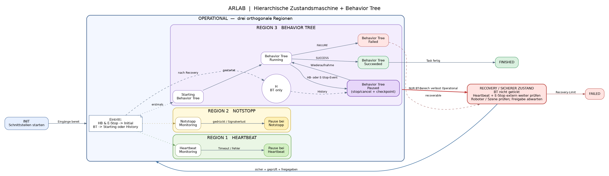

# Arlab – Decision Making (neuer Prototyp)

**Architektur:** Hierarchische Zustandsmaschine (HFSM) mit drei logischen
orthogonalen Regionen im Zustand `Operational` und einem externen
`Recovery`-Zustand. Die eigentliche Aufgabe wird mit `py_trees` ausgeführt.



## Dateistruktur

```text
arlab_decision_making/
├── arlab_decision_making/
│   ├── main.py                 # ROS-2-Einstieg, Parameter, Topics, Services
│   ├── state_machine.py        # HFSM / drei orthogonale Regionen / History
│   ├── heartbeat_monitor.py   # Heartbeat-Status und Timeout
│   ├── estop_monitor.py       # Notstopp-Status (prototypischer Adapter)
│   ├── bt_controller.py       # BT starten, canceln, wiederaufnehmen
│   ├── recovery.py            # Recovery-Freigabebedingungen und TODO-Hooks
│   ├── prototype_actions.py   # gemeinsame PyTrees-Action-Basis
│   ├── laundry.py             # fünf übergeordnete Laundry-Prozesse
│   ├── pick_and_place.py      # zehn Pick-and-Place-Prozesse
│   └── demo.py                # Simulation ohne ROS
├── test/
├── architecture.svg / .png
├── setup.py / setup.cfg / package.xml
└── README.md
```

## Semantik der State Machine

- **INIT:** Warten auf gültige Heartbeats aller konfigurierten Module und
  ein frisches, nicht aktives E-Stop-Statussignal. Kein BT-Start ohne Freigabe.
- **OPERATIONAL:** `Heartbeat Monitoring`, `Notstopp Monitoring` und
  `Behavior Tree Running` bilden drei orthogonale Regionen.
- **Heartbeat-Störung:** Die Heartbeat-Region wechselt nach
  `Pause by Heartbeat`. **Nur** der BT-Bereich wechselt nach `BT Paused`
  und löst den Übergang in das externe `RECOVERY` aus.
- **Notstopp:** Analoger Ablauf über `Pause by E-Stop` -> `BT Paused` ->
  `RECOVERY` (keine direkten Übergänge von den Monitor-Regionen).
- **RECOVERY:** Beide Beobachter erhalten über ihre ROS-Subscriptions weiterhin
  Signale. Die **orthogonalen Zustände** sind jedoch verlassen. Der BT wird
  hier nicht getickt. Vor Rückkehr müssen frische Heartbeats und ein freier
  E-Stop vorliegen, die Umgebung geprüft und der Wiederanlauf genehmigt sein.
- **WIEDEREINTRITT:** Die beiden Monitor-Regionen gehen wieder in den jeweiligen
  `Monitoring`-Initialzustand. Allein der BT-Bereich verwendet `History`:
  Eintritt in `BT Paused` -> `BT Running` durch explizite Wiederaufnahme.
- **BT SUCCESS:** `FINISHED`. **BT FAILURE:** Recovery-Versuch; nach
  `max_recoveries` erfolglosen Versuchen `FAILED`.

**Die orthogonalen Regionen sind in `state_machine.py` ausdrücklich durch
separate Zustandsvariablen und ereignisgesteuerte Übergänge modelliert.** Dies
ist ein schlanker HFSM-Prototyp und **keine vollständig implementierte
UML-Statechart-Engine**. Die ROS-Callbacks/Timers laufen unabhängig vom
BT-Timer; ein einzelner Zustandslock verhindert parallele Zustandsmutationen.

### Was History beim Behavior Tree bedeutet

Die HFSM merkt sich nach einer Unterbrechung `BTRegion.PAUSED` (History).
Das ist **nicht dasselbe wie** der interne Fortschritt eines PyTrees.
Zusätzlich speichert `TaskContext.completed` die bereits abgeschlossenen
Prozess-IDs. Beim Resume wird der Baum neu aufgebaut. Diese Prozesse liefern
sofort `SUCCESS`, während die **unterbrochene Aktion von vorn** beginnt.
Nach Prozessneustart sind diese Checkpoints derzeit verloren.

**TODO:** Persistente Checkpoints; tatsächliche Action-Goal-Cancellation,
Ergebnisabgleich, Idempotenz-/Wiederanlaufprüfung für Greifen und Ablegen.

## ROS-2-Schnittstellen

| Schnittstelle | Typ | Zweck / Stand |
|---|---|---|
| `/global_heartbeat` | `std_msgs/msg/Int32MultiArray` | Bestehende Arlab-Konvention `[module_id, status]` (-1 register, 0 OK, >0 Fehler) |
| `/arlab/estop_active` | `std_msgs/msg/Bool` | **Nur prototypischer Status-Adapter**, noch **keine** echte Teach-Pendant-Anbindung |
| `/decision_maker/confirm_recovery_checked` | `std_srvs/srv/Trigger` | Manuelle Testfreigabe statt zukünftiger Umwelt-/Roboterprüfung |
| `/decision_maker/authorize_restart` | `std_srvs/srv/Trigger` | Wiederanlauf-Freigabe für Prototyp |
| `/decision_maker/state` | `std_msgs/msg/String` | JSON-Diagnose der HFSM-Zustände |

**TODO: Noch nicht angebunden:**

1. E-Stop-Status direkt aus Robotersteuerung/Teach-Pendant.
2. Physikalisch sicherer Stop durch einen unabhängigen Safety-Mechanismus,
   z. B. sicherheitsgerichtete Robotersteuerung. Ein ROS Bool ist das nicht.
3. ROS-Action-Clients für Navigation, Perzeption, Greifen, Kommunikation.
4. Zuverlässiges Abbrechen und Quittieren laufender ROS-Action-Ziele.
5. Knowledge-Base-Invalidierung, Robot-/Szene-Verifikation und Operatoren-HMI.
6. Persistente Checkpoints und Behandlung nicht idempotenter Manipulationen.
7. Überwachung des **Supervisors selbst** durch externe Infrastruktur.

**Sicherheitsgrenze:** Das Paket ist ein Architekturprototyp und darf nicht
als Sicherheitsfunktion an echter Hardware eingesetzt werden. Insbesondere
unterbricht das Aussetzen des BT-Tickings keine laufende Bewegung automatisch.

## Start im vorhandenen ROS-2-Workspace

Aus dem Ordner mit `code/` als ROS-2-Paketquelle:

```bash
source /opt/ros/jazzy/setup.bash
colcon build --packages-select arlab_decision_making --symlink-install
source install/setup.bash

# Nur Mock-Actions: die Hardware wird durch diese Aktionen NICHT gefahren.
ros2 run arlab_decision_making decision_maker --ros-args \
  -p task:=laundry \
  -p simulate_actions:=true \
  -p heartbeat_module_ids:="[1, 2]"

# Alternative Task-Auswahl:
ros2 run arlab_decision_making decision_maker --ros-args \
  -p task:=pick_and_place -p simulate_actions:=true
```

Der Ros-Node startet im Zustand **INIT** und wartet auf aktuelle Eingänge.
Bei einem echten Arlab-Setup müssen die bestehenden lokalen Safety-Nodes
Heartbeat-Nachrichten liefern. Für isolierte Tests ohne diese Nodes können
zwei separate Terminals die Nachrichten senden:

```bash
ros2 topic pub --rate 5 /global_heartbeat std_msgs/msg/Int32MultiArray \
  "{data: [1, 0]}"
# Zweites Terminal:
ros2 topic pub --rate 5 /global_heartbeat std_msgs/msg/Int32MultiArray \
  "{data: [2, 0]}"
```

Drittes Terminal: **nur Simulation** des E-Stop-Eingangs:

```bash
ros2 topic pub --rate 5 /arlab/estop_active std_msgs/msg/Bool \
  "{data: false}"
```

Ereignis auslösen (Publisher für `false` vorher anhalten oder durch `true`
ersetzen):

```bash
ros2 topic pub --once /arlab/estop_active std_msgs/msg/Bool \
  "{data: true}"
```

Die State Machine wechselt jetzt über `BT Paused` nach `RECOVERY`. Zur
Wiederaufnahme braucht sie **wiederholt frische, gesunde** Eingangssignale,
sowie beide folgenden Testquittierungen:

```bash
ros2 service call /decision_maker/confirm_recovery_checked std_srvs/srv/Trigger '{}'
ros2 service call /decision_maker/authorize_restart std_srvs/srv/Trigger '{}'
ros2 topic echo /decision_maker/state
```

Für normale Nutzung `simulate_actions:=false` belassen. Dann liefert jede
nicht implementierte Prozess-Action absichtlich `RUNNING` und niemals einen
falschen Erfolg.

## Pure-Python-Demo (ohne ROS, mit py_trees)

```bash
python3 -m arlab_decision_making.demo --task laundry --fault heartbeat
python3 -m arlab_decision_making.demo --task pick_and_place --fault estop
python3 -m arlab_decision_making.demo --task laundry --fault bt
```

## Tests

```bash
python3 -m pytest -q test
```

Die zustandsbasierten Tests in `test_state_machine.py` benötigen keine
ROS-Installation. Die eigentlichen Tree-Tests in `test_tasks.py` benötigen
`py_trees` und werden andernfalls übersprungen.

## Konventionen im Projekt

- Python PEP 8, Typannotationen, Docstrings.
- Komponenten getrennt; keine riesige State-Liste mit 65 einzelnen Actions.
- PDF-Prozessabschnitte werden als **5 Laundry**- und **10 Pick-and-Place**-
  High-Level-Actions angelegt; Details und Fehlerbehandlung gehören später
  in deren jeweiligen ROS-Nodes.
- Keine Battery-Low-Logik.
- Bestehender ROS-Startname `decision_maker` bleibt erhalten.
